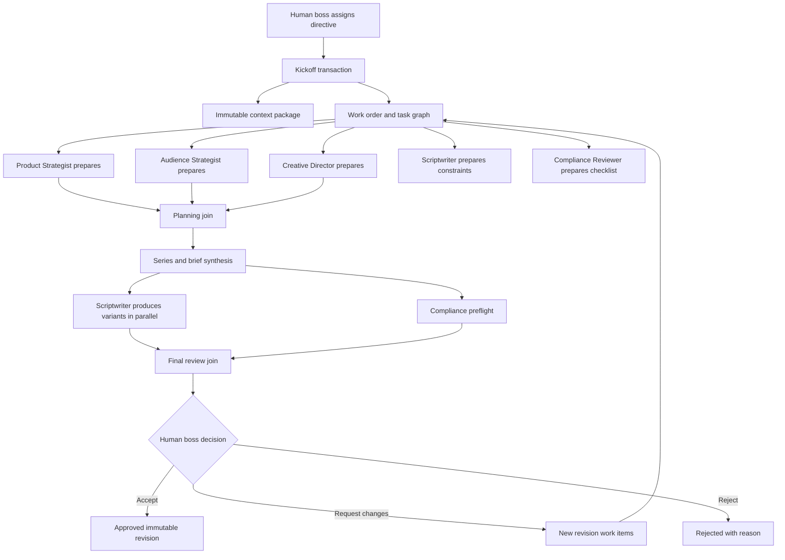

# Sprint 3 Proposed Plan — AI Creative Office

Status: Checkpoint A, Checkpoint B, and Checkpoint C implemented; Checkpoints D and E pending

Last updated: 2026-11-08

## 1. Product-owner intent

The Product Owner acts as the company boss. Instead of chatting with one generic assistant, the user assigns one business objective to an AI workforce. Every AI employee immediately prepares the part of the job that belongs to its role, visible inside a virtual office. Independent work runs in parallel; dependency-bound work prepares its context and checklist, waits honestly, then begins when its inputs are ready.

The reference HTML establishes the desired emotional model:

- A company office with a roster of named AI employees.
- A boss-level task composer.
- Visible departments, individual assignments, progress, reports, files, and activity logs.
- Inspectable employees and deliverables.

The reference is currently a timer-driven sequential simulation. Sprint 3 must replace simulated progress and sample reports with persisted work orders, real Gemini jobs, structured artifacts, evidence, review, and human approval.

## 2. Sprint 3 outcome

At the end of Sprint 3, an owner or editor can select a product and issue a directive such as:

> Lập kế hoạch nội dung và đạo diễn một series 5 video ngắn cho sản phẩm này.

The system will:

1. Freeze an authoritative context package from the product, confirmed facts, accepted analyses, brand voice, disclosure, and workspace AI policy.
2. Create one work order and a visible team assignment plan in one transaction.
3. Put all assigned employees into `preparing` at kickoff.
4. Run independent role jobs concurrently within workspace budget, provider rate limits, and worker concurrency limits.
5. Persist each result as a typed, versioned, evidence-linked artifact.
6. Synthesize the approved inputs into a campaign brief, video-series plan, scripts, and shot lists.
7. Run deterministic compliance lint plus an AI advisory review.
8. Present exact revisions to the human boss for accept, reject, or request-changes decisions.
9. Preserve an audit trail and a complete handoff package for Sprint 4 publishing work.

Sprint 3 does not generate or publish production video. It produces the plan, creative direction, scripts, shot lists, overlays, calls to action, and compliance-ready content package.

## 3. AI company roster

The first usable team is intentionally small. Each employee is a role configuration and structured-output contract, not a separate Google account.

| Employee | Department | Responsibility | Primary artifact |
| --- | --- | --- | --- |
| Chief of Staff | Strategy room | Deterministically decomposes the directive, owns the task graph, summarizes blockers, and assembles the handoff. It cannot approve content. | Work plan and executive summary |
| Product Strategist | Product desk | Converts confirmed product facts and accepted analyses into positioning, benefits, objections, constraints, and campaign goals. | Product campaign plan |
| Audience Strategist | Insight desk | Defines evidence-safe audiences, needs, objections, awareness stages, and content angles without inventing market facts. | Audience and angle board |
| Creative Director | Creative studio | Designs the short-video series, narrative arc, hooks, visual direction, continuity, and episode roles. | Video-series direction |
| Scriptwriter | Content desk | Produces platform-neutral scripts, voice-over, on-screen text, CTA, disclosure placement, and shot lists. | Content variants and scripts |
| Compliance Reviewer | Quality lab | Runs deterministic checks, verifies evidence references, lists unsupported claims, and produces advisory findings. It cannot approve. | Compliance report |

The office UI may visually show six employees, but the backend treats them as role definitions, assignments, runs, and artifacts. Avatars and walking animations never determine workflow state.

## 4. Parallel operating model

### Honest concurrency rules

- At kickoff, all assigned employees become `preparing` together.
- Employees with sufficient inputs move to `running` and may execute concurrently.
- Employees missing an input move to `waiting_dependency`, with the missing dependency shown in the UI.
- The UI never advances progress using a timer. Progress is derived from durable task and artifact states.
- A worker crash, provider outage, retry, or budget block is visible as a real state and never represented as successful work.
- A human decision is required at each approval gate. No AI employee may approve or publish its own work.

## 5. Core user experience

### 5.1 Boss command center

- Select workspace and product.
- Choose a mission template:
  - Product launch plan.
  - Five-video short-form series.
  - Objection-handling series.
  - Educational series.
  - Custom mission.
- Enter objective, target audience notes, desired number of variants, tone, constraints, and due-priority.
- Preview the confirmed facts and accepted analyses that will enter the context package.
- Preview estimated agent calls and reserved budget before kickoff.
- Press **Assign to AI Team** to create the work order.

### 5.2 Virtual office

The HTML reference becomes an optional visual command-center view:

- Left: real workflow stages and work-order progress.
- Center: office map with employee state derived from persisted assignments.
- Bottom: boss task composer and mission templates.
- Right: selected employee, current assignment, dependencies, latest report, artifacts, usage, retry state, and audit events.
- A board/list view remains available for accessibility, mobile use, and operational clarity.

Real visual states:

- `idle`: no assignment.
- `preparing`: validating context and reserving budget.
- `queued`: durable job exists.
- `running`: worker owns a live lease.
- `waiting_dependency`: named prerequisite not complete.
- `review_required`: artifact is ready for human inspection.
- `retry_wait`: transient failure with next-attempt time.
- `blocked`: policy, validation, or user-decision blocker.
- `completed`: structured artifact persisted successfully.
- `failed`: terminal safe failure.

### 5.3 Executive review room

- Compare role reports and identify disagreements.
- Inspect every claim and its confirmed fact/evidence reference.
- View structured artifacts rather than only chat history.
- Accept, reject, or request changes on an exact revision.
- Approve a final content package for future scheduling/publishing.

## 6. Structured artifacts

Chat is an interaction surface, not the source of truth. Sprint 3 stores typed artifacts:

- `work_plan`
- `product_campaign_plan`
- `audience_insight_board`
- `content_brief`
- `video_series_plan`
- `video_idea`
- `script`
- `shot_list`
- `caption_variant`
- `compliance_report`
- `executive_summary`

Every artifact has:

- Workspace, product, work-order, assignment, and author-role IDs.
- Schema and prompt-template versions.
- Immutable revision number and content hash.
- Evidence references to confirmed facts or accepted analyses.
- Provider/model provenance and safe usage metadata.
- Status: `draft`, `review_required`, `accepted`, `rejected`, or `superseded`.
- Human decision, actor, reason, and timestamp where applicable.

Unsupported creative suggestions must be labeled as hypotheses or creative direction. They must not be presented as verified product or market facts.

## 7. Proposed data model

No microservices or second database are introduced. PostgreSQL remains the source of truth.

### New tables

- `work_orders`: boss directive, product, context-package version, status, priority, budget reservation, timestamps, and version.
- `work_items`: one role assignment or synthesis/review unit with status, attempt policy, and output-artifact type.
- `work_item_dependencies`: explicit directed dependency graph.
- `agent_role_definitions`: versioned role name, allowed artifact types, prompt contract, and active flag. No credentials.
- `agent_assignments`: role instance assigned to a work item with visible office state.
- `context_packages`: immutable hashes and safe references to authoritative inputs; raw secrets and provider payloads are prohibited.
- `content_artifacts`: artifact identity, type, current revision, lifecycle status, and ownership.
- `content_artifact_revisions`: immutable structured JSON, content hash, provenance, and revision number.
- `artifact_evidence_refs`: artifact revision to fact/analysis references.
- `content_review_decisions`: human accept/reject/request-changes decision bound to an exact revision hash.

The existing durable `job_executions`, `operations`, `ai_runs`, `outbox_events`, workspace AI policy, and `audit_events` are extended/reused instead of duplicated.

## 8. API surface

Proposed `/api/v1` routes:

- `POST /workspaces/{workspaceId}/products/{productId}/work-orders`
- `GET /workspaces/{workspaceId}/work-orders`
- `GET /workspaces/{workspaceId}/work-orders/{workOrderId}`
- `POST /workspaces/{workspaceId}/work-orders/{workOrderId}/cancel`
- `POST /workspaces/{workspaceId}/work-orders/{workOrderId}/retry`
- `GET /workspaces/{workspaceId}/work-orders/{workOrderId}/activity`
- `GET /workspaces/{workspaceId}/work-orders/{workOrderId}/artifacts`
- `GET /workspaces/{workspaceId}/artifacts/{artifactId}`
- `POST /workspaces/{workspaceId}/artifacts/{artifactId}/accept`
- `POST /workspaces/{workspaceId}/artifacts/{artifactId}/reject`
- `POST /workspaces/{workspaceId}/artifacts/{artifactId}/request-changes`

Mutation routes use idempotency keys, mutation-origin validation, version/ETag preconditions, authorization, rate limits, safe Problem Details, and audit records. Sprint 3 uses polling against authoritative operation/activity state; WebSockets are not required for the MVP office animation.

## 9. Backend orchestration

- The application layer, not an AI model, creates the allowed task graph from an approved mission template.
- Gemini fills versioned structured-output schemas for role deliverables.
- A custom directive may adjust bounded inputs but cannot inject arbitrary agent tools or bypass evidence/approval policy.
- Kickoff transaction validates tenancy, product/fact readiness, AI policy, rate limits, and budget; then writes the work order, work items, dependencies, operations, durable jobs, outbox events, reservations, and audit event atomically.
- PostgreSQL leases and `FOR UPDATE SKIP LOCKED` support concurrent workers.
- Worker concurrency is bounded by configuration and workspace/provider policy.
- Join work items become runnable only when their declared dependencies complete successfully.
- Failed required dependencies block downstream tasks with a visible reason.
- Retry and budget settlement remain owned by the durable workflow; provider SDK retries stay disabled.

## 10. Security and safety

- Only active workspace members can view the office; role capabilities govern create, review, and policy actions.
- Confirmed product facts and accepted analyses are the only sources for affirmative claims.
- Product descriptions, source excerpts, user directives, and earlier AI artifacts are untrusted content, never system instructions.
- Agent roles have no browser, shell, social-account, publishing, payment, or secret-management tools in Sprint 3.
- Provider keys remain server-side and never enter context packages, artifacts, jobs, logs, or the browser.
- Output size, number of agents, number of variants, parallel calls, retries, and repair attempts are bounded.
- Budget is reserved before enqueue and atomically settled or released.
- Deterministic compliance checks fail closed for blocking rules; AI compliance output is advisory.
- Every human decision binds the exact immutable artifact revision and hash.

## 11. Checkpoints and delivery order

### Checkpoint A — Architecture and orchestration foundation

Goal: establish real work orders and a deterministic parallel task graph.

Deliverables:

- Approve the AI workforce ADR and role boundaries.
- Migration for work orders, work items, dependencies, role definitions, context packages, and audit constraints.
- Domain/application state machines and authorization matrix.
- Atomic kickoff transaction, idempotency, budget reservation, and outbox creation.
- Durable dependency release and bounded worker concurrency.
- API contracts and integration/concurrency tests.

Exit evidence:

- One directive creates all assignments atomically.
- Independent tasks become claimable together.
- Dependency-bound tasks show `waiting_dependency` without provider calls.
- Duplicate kickoff cannot create duplicate work orders or charges.

### Checkpoint B — First valuable vertical slice: parallel planning pod

Goal: give the Product Owner a usable result early.

Deliverables:

- Boss command center for a selected product.
- Product Strategist, Audience Strategist, and Creative Director role schemas/prompts.
- Parallel Gemini execution through the existing AI Gateway.
- Product campaign plan, audience/angle board, and five-video series plan.
- Work-order timeline, employee inspector, real status polling, usage, failures, and retry UI.

Exit evidence:

- One mission produces three independent, evidence-linked artifacts concurrently.
- Provider failure is visible and recoverable without fake completion.
- Owner can read useful planning outputs before later content-production work is finished.

### Checkpoint C — Content studio and immutable revisions (Implemented)

Goal: turn accepted planning into production-ready written assets.

Deliverables (Completed):

- Content brief synthesis: deterministic synthesis from the 3 planning artifacts, confirmed facts, accepted analyses, and workspace brand preferences into immutable `content_briefs`.
- Scriptwriter role execution: durable generation of a 5-video Vietnamese `script_package` as independent units (`script_generation_units`).
- 3-concurrency capacity gate: strict limit of maximum 3 concurrent running AI provider jobs per workspace across planning and scriptwriting stages.
- Short-video scripts, hooks, voice-over, scene breakdown, overlays, CTA, disclosure placement, and shot lists with bounded variants (1..3).
- Immutable artifact revisions (`content_artifact_revisions`), explicit lineage (`content_artifact_lineage`), and SHA-256 content verification.
- Human edit and request-changes workflows: full manual revision and targeted regeneration of selected videos (e.g. videos 2 & 4) with optimistic concurrency checks (`expectedVersion`, `baseRevisionNumber`, `baseContentHashHex`).
- Content Studio web UX: accessible five-video navigation rail, focused script reader/editor, revision history, and visual compare view.
- Explicit Checkpoint D boundary: Checkpoint C stops at assembling the `script_package` artifact and releasing `compliance_review` to `ready`. It stays strictly out of Checkpoint D (compliance rule engine, compliance reports, compliance findings, approval decisions, approval snapshots, and publishing).

Exit evidence:

- A five-video series has structured scripts and shot lists.
- Editing creates a new revision and never mutates an approved snapshot.
- Every affirmative product claim resolves to allowed evidence.
- Full quality gates pass clean: `pnpm format`, `pnpm check`, `pnpm test:integration`, `pnpm db:migrate:validate` (twice), `git diff --check`, secret scan.

### Checkpoint D — Compliance and human approval

Goal: make the package safe and explicitly human-controlled.

Deliverables:

- Versioned deterministic compliance rules.
- Compliance Reviewer advisory artifact.
- Blocking unsupported-claim/evidence checks.
- Accept, reject, and request-changes transitions bound to revision hashes.
- Final package approval and immutable audit history.

Exit evidence:

- AI cannot approve its own output.
- Material revision invalidates prior approval.
- Rejected and blocked artifacts cannot be handed to future publishing workflows.

### Checkpoint E — Virtual office experience and Sprint 3 release

Goal: deliver the “boss managing an AI company” experience without sacrificing operational truth.

Deliverables:

- Adapt the reference HTML visual language into Next.js components.
- Office/board view toggle, responsive inspector, keyboard navigation, reduced-motion mode, and screen-reader status summaries.
- Real state-driven employee movement, handoff animation, reports, files, and logs.
- Empty/loading/error/retry/budget/rate-limit/provider-outage states.
- End-to-end browser flow, accessibility checks, full PostgreSQL integration suite, build, threat review, and runbook.

Exit evidence:

- The office animation matches database state and survives refresh/restart.
- A board view exposes the same information without the canvas.
- No timer-generated progress, fake files, or fake success remains.

## 12. Recommended sprint acceptance scenario

1. Owner signs in and opens a product with confirmed facts.
2. Owner assigns: “Lập kế hoạch và đạo diễn series 5 video ngắn.”
3. The office shows all employees preparing immediately.
4. Three planning roles run concurrently and publish real artifacts.
5. The system synthesizes a content brief and starts script variants.
6. Compliance finds or clears unsupported claims.
7. Owner requests one change, compares the new revision, and accepts the final package.
8. Refreshing or restarting processes preserves all states, artifacts, usage, and audit history.
9. The approved package is ready for Sprint 4 but nothing is published externally.

## 13. Testing strategy

- Domain tests for every valid and invalid state transition.
- PostgreSQL tests for tenant isolation, task dependencies, lease fencing, parallel claims, duplicate kickoff, budget races, retry settlement, immutable revisions, and approval conflicts.
- Adapter contract tests for every role schema, evidence validation, invalid output, timeout, rate limit, provider outage, and one repair maximum.
- API tests for authentication, authorization, origin validation, idempotency, ETags, pagination, safe errors, and no-store headers.
- Web tests for office/board parity, visible blockers, stale workspace switches, accessibility, reduced motion, and responsive layouts.
- Controlled fake-provider end-to-end flow for normal CI.
- One opt-in live Gemini smoke that never claims success when the provider fails.

## 14. Cost and quota controls

- All employees initially use the configured Gemini provider through the existing gateway; the system does not automate Gemini/ChatGPT consumer websites.
- One employee does not require one provider account. Roles share the workspace provider configuration and policy.
- Before assignment, show maximum agent calls, maximum variants, reservation, and remaining workspace budget.
- Default bounds for the first release:
  - Maximum 6 assigned roles per work order.
  - Maximum 3 simultaneously executing provider calls per workspace.
  - Maximum 5 video ideas and 3 variants per selected idea.
  - One structured-output repair attempt.
  - Existing durable transient retry policy.
- Prompt/context reuse and compact context packages reduce repeated tokens without hiding usage.

## 15. Explicit non-goals

- No production image or video generation/editing.
- No social account connection, scheduling, or publishing before Sprint 4.
- No fake employees, simulated reports, arbitrary percentages, or timer-only completion.
- No unofficial provider APIs, browser automation of AI chat products, quota bypass, or secret sharing.
- No autonomous approval, fact confirmation, spending changes, or publishing.
- No general-purpose agent tool execution, shell access, crawling, or open-ended web research.
- No microservices, Kafka, Kubernetes, event sourcing, or second database.

## 16. Product Owner decisions requested

Recommended defaults are provided so implementation can begin quickly after approval:

1. Approve six visible roles: Chief of Staff, Product Strategist, Audience Strategist, Creative Director, Scriptwriter, and Compliance Reviewer. **Recommended: approve.**
2. Make the office view optional and keep an equivalent board view. **Recommended: approve for accessibility and operational clarity.**
3. Deliver Checkpoint B before polishing office animations so the sprint creates business value early. **Recommended: approve.**
4. Keep Sprint 3 limited to planning, scripts, shot lists, revisions, compliance, and approval; defer real video generation. **Recommended: approve.**
5. Use bounded polling for live status in Sprint 3 instead of introducing WebSockets. **Recommended: approve.**
6. Use a maximum of three concurrent Gemini calls per workspace initially. **Recommended: approve, then tune from measured latency/quota.**

After these decisions are approved, Codex will produce the Sprint 3 ADR and the first implementation task for Checkpoint A.
